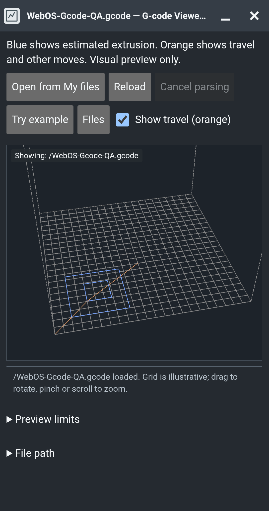
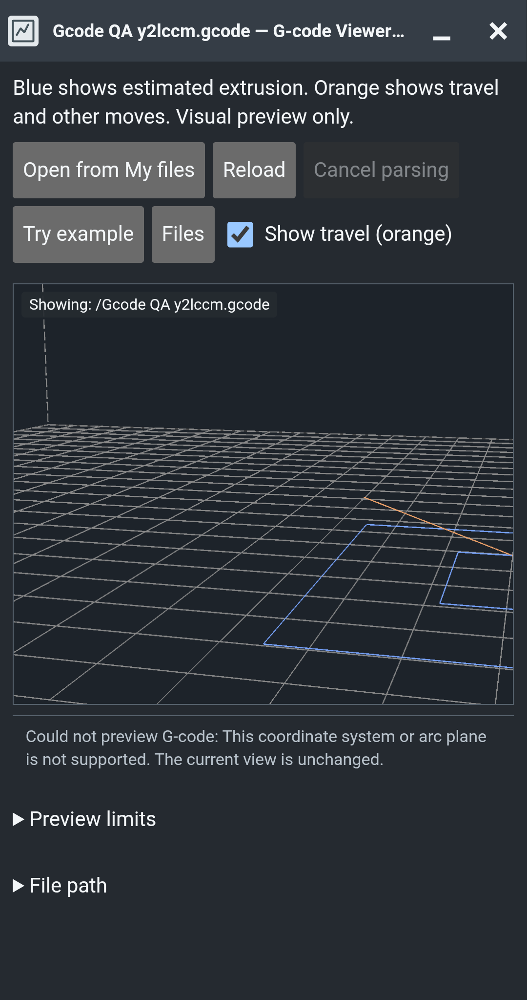
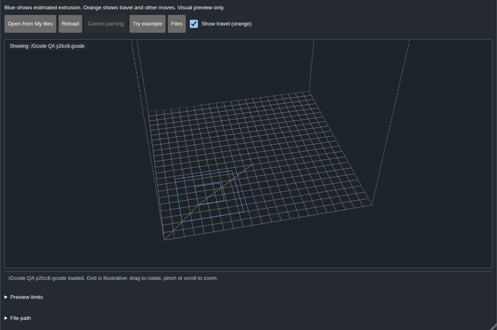

# G-code Preview in WebOS

The November 26, 2026 check used viewer `118de96a1ce34be8046cec094e74570868e95f8ddd0e33ef828c2e24e2377627` and app source `eaccff8`. The app's dark surfaces match WebOS. The earlier gray viewer showed pale guidance text on a pale panel. The new legend and status are readable alongside the blue extrusion paths and orange travel moves.

Open **3D Printing → G-code Viewer (G-code Preview)** and choose **Try example**, or use **My files → Upload** to bring in a real toolpath. Opening `.gcode`, `.gco`, or `.nc` from My files uses G-code Preview. **Open With → Text Editor** is available for editing the source. The viewer picker also accepts `.ngc`, `.gc`, `.g`, and `.tap`. The app renders the file as a visual preview and leaves the original bytes in My files.

## Physical phone workflow

1. Upload a `.gcode` toolpath through Android Files. Select it in My files and tap **Open**. The sample with two square layers shows two blue paths and orange travel.
2. Drag on the view to rotate. Pinch to zoom. Toggle **Show travel** to hide or reveal the orange moves.
3. Cancel **Open from My files** to keep the view. Pick a file with the unsupported `G54` command and confirm that the original geometry and source label remain visible.
4. In a signed-in session, close the app and reopen the same file from My files after signing in again.

The Galaxy S10+ tested Chrome `158.0.8127.92` at 411 CSS pixels in portrait, including a real Android file-picker upload, default routing, exact source bytes after fresh sign-in, and the additional `.ngc` selection in the viewer. The Moto G 5G tested Chrome `158.0.8127.42` at 822 CSS pixels in landscape. It completed guest open, rotate, pinch, travel toggle, cancel and invalid-file recovery. Its preview fits below the controls and the lower details can scroll.

## Desktop and tablet

Desktop Chromium tested a 1300 CSS-pixel window with mouse and keyboard. The two devices completed eight of ten workflows from the qualification list. The automatic window restore and source-change notification with reload still have checks pending for this build. Chromium touch emulation at 820 × 1050 CSS pixels loaded the example, toggled travel and kept the WebOS app bar visible. Seven app reference tests and 13 Files routing tests passed.

The app entry is `index.mjs`. The browser package uses the committed dependency lock, the WebOS app registry and the continued patched `gcode-preview` renderer and worker. This release reused the verified renderer, parser worker, and notices from the preceding viewer. The Files bundle includes the source association from WebOS and the Desktop validates the selected file's workspace and revision. [Supported files and build notes](../../README.md)
